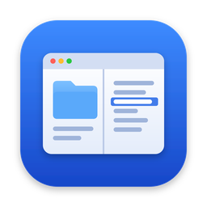
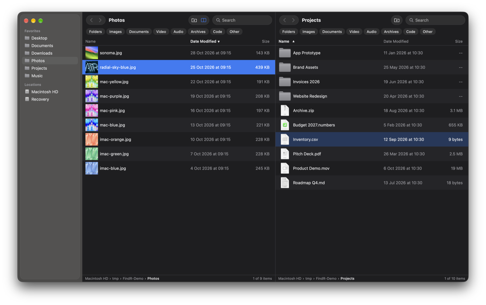

<div align="center">



# FindR

**A fast, keyboard-first file manager for macOS, with split view, instant search and a native feel.**

[](LICENSE)




</div>

FindR is a file manager for people who live on the keyboard but still want Finder's look and comfort. It opens folders instantly, shows two of them side by side, and lets you filter or search as soon as you start typing. Its core is written in Rust and its interface in React, packaged with [Tauri](https://tauri.app), so it stays small (about 12 MB) and quick.

## Features

**Browsing**
- **Split view.** Two folders side by side (⌘\\), with drag and drop between them. Tab switches panes.
- **Type to search.** Start typing anywhere and the list filters by name. Turn on *Subfolders* to search everything below the current folder. Documents, Desktop and Downloads are indexed and kept up to date as files change, so searching them is instant, and folders like `node_modules`, `.git` and `build` are skipped. Both lists can be changed in Settings.
- **Filter by kind.** One-click chips for folders, images, documents, video, audio, archives and code.
- **Real previews.** Thumbnails for photos, videos and PDFs, Quick Look on Space, and live updates when files change on disk.
- **Sorting like Finder.** Sort by name, date modified, date created, kind or size. Folders stay on top only in name order.
- **A sidebar that's yours.** Drag folders in to pin them, reorder them, and resize or hide the sidebar (⌘B). Mounted volumes appear on their own.

**Working with files**
- **Copy, cut and paste** with ⌘C, ⌘X and ⌘V. FindR uses the system clipboard, so you can copy in Finder and paste in FindR, or the other way round.
- **Drag and drop** within FindR, onto sidebar folders, or out to any other app. Folders spring open when you hover over them, ⌥ copies instead of moving, and the drag shows tilted previews of the files.
- **Name clashes** prompt you to Replace, Keep Both or Skip, with an option to apply the choice to every clash.
- **Convert files** from the right-click menu, one at a time or a whole selection at once (even of mixed types): images to PNG, JPEG, HEIC, WebP or TIFF; video to MP4 or MOV; audio to MP3, M4A or WAV. Settings choose whether the converted file replaces the original or sits next to it. The conversion runs locally with macOS’s own tools.
- **Rename, new folder, Move to Trash** and *Show in Finder* are all one keystroke or click away.

**Fits into macOS**
- **A unified toolbar** with a translucent sidebar, like Finder's.
- **`findr://` links** open a folder from anywhere: Raycast, Alfred, Shortcuts, scripts or a browser. See [Links](#links).
- **Settings** (⌘,) let you choose which columns to show. Your favourites, sorting, column choice and layout are kept between launches.

## Install

FindR doesn't have a release download yet, so for now you build it from source. This takes a few minutes, and the steps are under [Building from source](#building-from-source).

FindR is built and tested on macOS on Apple Silicon.

## Keyboard shortcuts

| Action | Shortcut |
|---|---|
| Search this folder | just start typing, or ⌘F |
| Open selection | ⌘↓ or double-click |
| Enclosing folder | ⌘↑ |
| Back / Forward | ⌘[ / ⌘] |
| Go to folder… | ⇧⌘G |
| Quick Look | Space |
| Rename | Return |
| New folder | ⇧⌘N |
| Copy / Cut / Paste | ⌘C / ⌘X / ⌘V |
| Move to Trash | ⌘⌫ |
| Select all | ⌘A |
| Extend selection | ⇧↑ / ⇧↓ |
| Split view on / off | ⇧⌘S |
| Open the right pane | ⌘\\ |
| Close pane | ⌘W |
| Switch pane | Tab |
| Toggle sidebar | ⌘B |
| Add folder to sidebar | ⌃⌘T |
| Show hidden files | ⇧⌘. |
| Bigger / smaller rows | ⌘+ / ⌘− |
| Settings | ⌘, |

## Links

FindR registers the `findr://` URL scheme. Any app that can open a URL can open a folder in FindR:

```sh
open "findr://~/Downloads"              # a folder in your home folder
open "findr:///Users/Shared"            # an absolute path
open "findr://~/Documents/Report.pdf"   # opens the folder with the file selected
```

Spaces and other special characters can be percent-encoded (`My%20Folder`).

## Building from source

You need:

- macOS with the Xcode Command Line Tools: `xcode-select --install`
- [Rust](https://rustup.rs) (stable)
- [Node.js](https://nodejs.org) 20.19 or later

```sh
git clone https://github.com/Luis0Antonio/FindR.git
cd FindR
npm install

npm run tauri dev                  # run with hot reload
npx tauri build --bundles app      # build target/release/bundle/macos/FindR.app
```

To install your build, copy `FindR.app` into `/Applications`. If you have an Apple Developer certificate, set `APPLE_SIGNING_IDENTITY` before building to sign the app.

Run the core tests with:

```sh
cargo test -p fs-core
```

## How it's built

```
crates/fs-core/   Pure-Rust file system core: listing, sorting, search, copy/move, names. No UI, fully tested.
src-tauri/        The macOS app: Tauri commands, file watching, thumbnails, Quick Look, drag out,
                  clipboard and file conversion, using AppKit through objc2.
ui/               The interface: React 19, TypeScript and Zustand, with a virtualised list for large folders.
```

- **Fast listing.** Folders are read in Rust and sent to the UI in one go, and the list renders only the rows on screen, so very large folders stay responsive.
- **Native where it matters.** Thumbnails come from Quick Look, icons from NSWorkspace, and drag and clipboard use AppKit directly, so other apps see FindR's files exactly as they would Finder's.
- **Safe by default.** Deleting moves files to the Trash, replacing a file trashes the old one first, and a folder can't be moved into itself.

## Contributing

Bug reports, ideas and pull requests are welcome.

- **Bugs:** open an [issue](https://github.com/Luis0Antonio/FindR/issues) with your macOS version and steps to reproduce.
- **Pull requests:** keep each one focused on one change. For anything large, open an issue first so we can agree on the approach.
- **Style:** format TypeScript with `npx prettier --print-width 160` and keep Rust in the surrounding style (lines up to 160 characters). Comments explain *why*, not *what*.
- **Before you push:** make sure `cargo test -p fs-core` passes and `npx tsc --noEmit -p ui` is clean.

## License

FindR is released under the [MIT License](LICENSE).
